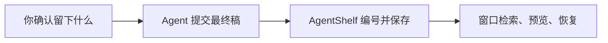

AgentShelf 保管各 AI Agent 值得留下的最终成果，并记下编号、来源 Agent、所属项目和归档时间。它供一个人在自己的电脑上使用，支持 macOS 与 Windows。

## 谁来做什么

你确认哪些文件值得留下。Agent 把这些文件交到 AgentShelf。AgentShelf 保存、编号、建立版本，并在窗口里展示。

各 Agent 保持原来的工作方式。安装一次通用 Skill 后，就可以把最终稿交到同一个库。更换 Agent 之后，已经归档的文件和版本仍在。不想通过 Agent 归档时，直接把文件拖进窗口。两种方式的去重和版本规则相同。

## 一份产物里有什么

| | 进入产物库 | 留在 Agent 会话 |
|---|---|---|
| 内容 | 文档、代码、图片、报告、数据文件，以及后来的修改 | 思考过程、工具调用、临时中间稿 |
| 身份 | 稳定编号。两个项目里都叫 `README.md`，也不是同一份 | 对话自己的上下文 |
| 位置 | 复制进本机数据目录。项目里的原文件不动 | 仍在原来的对话或文件夹 |

:::caution 敏感文件
像密钥、令牌或私钥这样的文件，需要你明确同意后才归档。
:::

## 归档

对 Agent 说「把这份最终稿归档到 AgentShelf。」即可。它归档当前这份最终稿，并自行填上名称、项目、标签和来源。

| 信息 | 从哪里来 | 之后能改吗 |
|---|---|---|
| 名称 | 文档标题；没有标题时用文件名 | 能。在详情里编辑，不产生新版本 |
| 项目 | 当前项目 | 能 |
| 标签 | 根据内容归纳的几个短标签 | 能 |
| 来源 | 正在使用的 Agent | 能 |

同一份成果里的多个文件放进同一份产物。彼此独立的成果分开归档。

自己拖进窗口时，选中文件后再填写这些信息，都可以留空。名称留空时，使用去掉扩展名后的文件名。

:::warning 相同内容不会按文件名覆盖
内容已经存在时，AgentShelf 列出候选产物，由你选择新建一份，或追加到指定的那一份。相同内容只保留一份物理文件。选择「新建产物」不会再复制一份相同的字节。
:::

## 产物库与版本

产物库是一行一条的列表，按最近更新排列。一份产物里有多个文件时，直接标出文件数。

可以按项目、标签、来源 Agent 和格式筛选。输入检索词之后，才选择全文、语义或混合。筛选和检索词写在地址里：从详情返回、点侧边栏的「产物库」，或刷新页面，条件都还在。

只有一个可预览文件时，详情直接打开预览。有多个文件时，先列出文件，点开后再预览；预览上方的标签可以切换其他文件。返回只往上退一级：先回到文件列表，再回到产物库。

每次成功归档或恢复，都会留下一个不再改动的版本。恢复的含义是：按所选历史版本的内容再建一个新版本，并把它设为当前版本。中间的版本还在，版本号继续增加。

删除产物前会要求确认。删除后，这份产物不能再从库里打开。

## 能直接看的格式

| 格式 | 在窗口里 |
|---|---|
| Markdown、文本 | 直接阅读 |
| CSV | 表格，最多 200 行、40 列 |
| JSON | 文本，过长会截断并标明 |
| PNG、JPEG、GIF、WebP | 图片 |
| PDF | 直接预览 |
| SVG | 提供下载 |
| Office 文档、压缩包、数据集等 | 保存并提供下载 |

预览失败只影响这一份文件。文件仍可下载。下载和校验都会核对其内容是否与记录一致。

## 文件放在哪里

具体位置在设置页可以查看、复制和打开。AgentShelf 只在本机使用，不扫描整块磁盘。

| 系统 | 默认位置 |
|---|---|
| macOS | `~/Library/Application Support/AgentShelf` |
| Windows | `%LOCALAPPDATA%\AgentShelf` |
| Linux | `~/.local/share/AgentShelf` |

语义检索是可选项，模型由你自己放在本机。未启用时，全文检索、预览和备份仍然可用。
